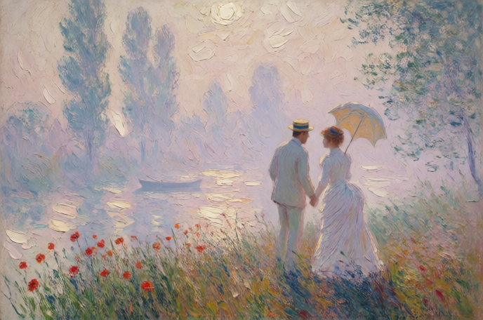

弗洛姆在《爱的艺术》当中就讨论了，人们之所以会寻求爱就是因为有着无法克服的分离焦虑，也就是说，人的本质是非常害怕孤独的。这里的孤独不是指独自一人生活，而是一种与人没有任何深度连结的状态。人是需要被看见，被认同，被接纳的，我们就是在与人的关系中感觉到自己是重要的，有意义的。也正因为如此，我们才不遗余力地追寻爱，以至于模糊了它本来的面目。

真诚的爱首先要**认识孤独**。只有承认孤独的力量我们才会从根本上反思自己爱的动机。孤独是我们所有人的最终归宿，不管是父母、子女还是伴侣都无法陪伴我们走完一生。这三者如接力棒一样努力参与我们的生活，但也只能陪伴我们大部分的人生，最终我们还是要独自面对衰老和死亡。因此，孤独没法克服，只能接受它。然而，大多数时候，人们都选择轻视或掩盖这个议题，认为有人陪伴一切就都迎刃而解了。于是不假思索地让自己不断地处于关系中，哪怕身处其中感觉很痛苦也觉得比没有要好。遗憾的是，这是种自我欺骗，人依然是孤独的。所以，与其花时间想怎么避免孤独，不如想想该如何接纳孤独。当你拥有了面对孤独的勇气和方法后再去爱也不迟。

其次，爱是**给予**而非索取。当今娱乐至死的社会现状催生了一种伪罗曼蒂克爱情观，宣扬爱是一种享受。于是，认为一昧地要求对方满足自己，将舒服最大化是理所应当的。一旦轮到自己需要付出的时候就会很吝啬，因为这破坏了他们的“享受”。这就是一种无底线的索取，这样的人从来不给予，自然也就没有爱。弗洛姆说：“给予是创造爱的能力，无爱则不能创造爱。” 事实上，没有什么是理所应当的，只不过是对方愿意罢了。给予是令人愉悦的，通过这样一种活动，人把自身有活力的东西展现出来充实了另一个人的生命，即使没有回报也全然接受，因为这是他发自内心的，在爱里不讲得失。很多人会因为不对等的回馈而伤心欲绝，实际上大可不必，这还是受困于计算思维。其实，只要你付出了给予了，就说明你给得起这一切，你是一个“富裕”的人，你应该为自己感到高兴，你是那个真正懂爱的人。以上讨论的都不是物质层面的给予，给出物质不算给予，真正难的是将自己全然交付对方，因为这意味着让对方把握伤害你的权利，这需要极大的勇气和信念，要求你相信自己并相信他人。在爱中，给予意味着充盈，反之，则是匮乏。

匮乏来自于不够稳定**自洽的内核**。现实生活中，由于功绩社会的逼迫，大部分人更关心生产效率和标准，从而根本不想，也没法形成自己的内核。这也是大家生活得那么痛苦的原因。空洞的内核让我们无力抵抗社会生产机器的攫取，精疲力尽，一击即溃，根本无法生产出力量来支撑自己。要知道，这个世界有太多牛鬼蛇神如泥石流般向我们扑来，如果没有强大的内心像树根一样牢牢扎稳在泥土里，就会被轻而易举地卷走，更别提拉住另一个人了。

想要充盈饱满起来，就要**认识自己**。一方面，要明确地感知我们所有的情感，包括喜怒哀乐、焦虑、抑郁、恐惧等，压抑是回避问题的手段，我们需要做的是接纳它们。另一方面，摆脱理想化形象。卡伦·霍妮在《我们内心的冲突》当中讨论到，人们依赖理想化形象以弥合和现实的差距，倾向于把自己想得完美善良而又无辜，这当然是一种自欺欺人。要知道，我们既是“天使”也是“魔鬼”，我们既会慷慨解囊温柔待人，也会自私虚伪伤害别人。很多人拒绝承认自己虚伪的一面，就是太过依赖理想化形象，把自己架在空中楼阁，这也是一种自我欺骗，实际是十分脆弱的。最后，是建立成体系的价值观。这是我们看待世界的方式以及为人处事的基本原则，是关于我们自己的哲学。不成熟的人的价值观体系是混乱矛盾的，判断力是十分低下的，青少年时期的我们就是这样的，所以那时的我们没法对任何人负责，也因此我们需要父母的指导。但是当我们成年以后，就要摆脱权威，不要试图依靠任何力量来指引我们该怎么做，而是让自己成为自己的引路人，自己做决定，并为此负责。错了也没关系，承担该承担的，弥补该弥补的，重新出发。综上所述，我们就是在完善对自己的认知的过程中形成强大的内核和信念感以便保护自己和他人。认识自己是爱的能力的基础。

此外，如果我们知道什么是爱，就不会只爱一个对象，而是爱我们身边的一切，包括父母、朋友、同胞。更重要的是，我们要**爱自己**。我们自己也是我们的感觉对象，对待他人的态度也和对待自己的态度是连在一起的。如果你没有什么坚信的东西，甚至都不相信自己，那么你也无法相信他人。还是那句话，要认识自己。

最后，在了解自己以后，别忘了倾听他者的声音，让他者走进你的世界。很多人喜欢站在自己的角度去揣摩对方的感受，经常说“我觉得他是XXX想的”，美其名曰共情，实质还是自我。就仿佛很多已经有一个宠物的人还想再养一个，美其名曰怕它孤单，但实际上就是自我臆测罢了，宠物本身可能并不觉得孤独。类似这种“我觉得他”这样的错误表述是具有很强的自我暗示性和误导性的。我们经常在过分宠溺的父母身上经历这种情况，并对此深感厌恶，但实际上我们自己也这么对别人。这不是倾听他者，是封闭他者。应当摆脱“我觉得”，在现实层面直接向他”发问——“你是什么感受？跟我说说吧。”

另外，在关系中，二者总是纠结于是以“我”为主，还是以“你”为主。以单独的个体为视角是我们的初始设置，这样进入关系是狭隘的，无论如何，二者都会走到对立斗争的结局。实际上，既非“我”也非“你”，而是**“我们”**。当思维转换到“我们”时，二者是命运共同体的关系，我们将努力付诸在关系上，让关系成就个体，一切就都变得自然而然了。

爱的确是需要学习的。可惜的是，我们的教育并不包含这一门功课，只能在生活中跌跌撞撞地摸索，而大部分的人终其一生都很迷茫。于是人们喜欢讲“缘分”，进行不下去的关系就是“缘分未到”，但实际上哪有“缘分”这种东西，只不过双方解决问题的智慧和能力不足。爱是一门艺术，而艺术的智慧来源于生活和实践。就好比画画，仅仅停留在理论而不去生活中感知美，也不拿起笔和纸练习技艺把美传达出来，是无法成为艺术家的。

以前，人们结合是为了规避风险，其本质一种利益结盟；现在，疲惫不堪的人们的灵魂早就被吃干抹净，在生产过剩的物质世界里陷入集体性精神空虚，连利益结盟都无力应对。书中也花费了很大篇幅讨论了当代西方资本主义社会下爱的消解问题，更进一步的，是我们人类社会消解的问题。不仅是弗洛姆，很多学者都认为如今爱欲已死，因此，重提爱的哲学议题很有必要。这需要我们返璞归真式的反思和学习，让它起死回生。**==在爱中，我们学会成为自己的主人并向世界主动发出声音。==**

